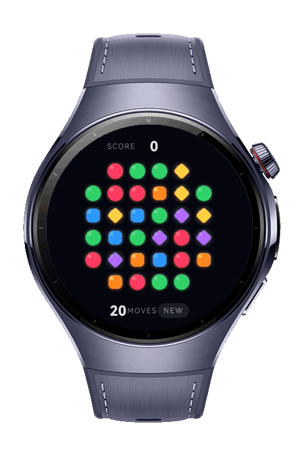

> **Note:** To access all shared projects, get information about environment setup, and view other guides, please visit [Explore-In-HMOS Index](https://github.com/Explore-In-HMOS/hmos-index).

# How to Make Sweet Match
This sample demonstrates how to build a match-3 candy game for HarmonyOS wearables. Candies are swapped with a **swipe** or two **taps** on a 6x6 board shaped for the round watch face, matches of 3 or more are cleared with cascading **combos**, and the score fills a **progress ring** around the screen until the target is reached within the move limit

# Preview
<div>
  
</div>

# Use Cases
- Swap two neighbouring candies with a swipe, or tap one candy and then its neighbour
- Clear horizontal and vertical runs of 3, 4, 5 or more candies for 60, 150, 300 and 500 points
- Chain cascades after gravity and refill, multiplying the score by the combo count
- Undo a swap automatically when it does not create a match, without spending a move
- Reshuffle the board automatically when no valid move is left
- Reach 2000 points within 20 moves to clear the level, with the progress ring showing how close you are
- Get vibration feedback on selection, invalid swaps, matches, combos and the end of the game

# Tech Stack
- **Language:** ArkTS
- **Framework**: HarmonyOS SDK 6.0.2(22)
- **Tools** DevEco Studio 6.0.2
- **Libraries**:
  - **ArkUI:** `PanGesture` and `onClick` for swipe and tap input, `animateTo` for clear and fall animations, `Progress` ring for the score target.
  - **Sensor Service Kit:** `vibrator` used for haptic feedback.
  - **Basic Services Kit:** `BusinessError` used for typed error handling.

# Directory Structure
```
entry/src/main/
├── ets/
│   ├── entryability/
│   │   └── EntryAbility.ets                # Ability entry
│   ├── game/
│   │   └── Board.ets                       # Board shape, match finding, scoring, gravity, refill and move check
│   └── pages/
│       └── Index.ets                       # Game screen, input, animations, haptics and result overlay
└── module.json5                            # Wearable device type and vibrate permission
```

# Constraints and Restrictions
## Supported Devices
- Huawei wearables running HarmonyOS 6.0.0(20) or later

## Permissions
- `ohos.permission.VIBRATE` is required for haptic feedback

# License

**How to Make Sweet Match** is distributed under the terms of the MIT License. See the [LICENSE](LICENSE) for more information.
